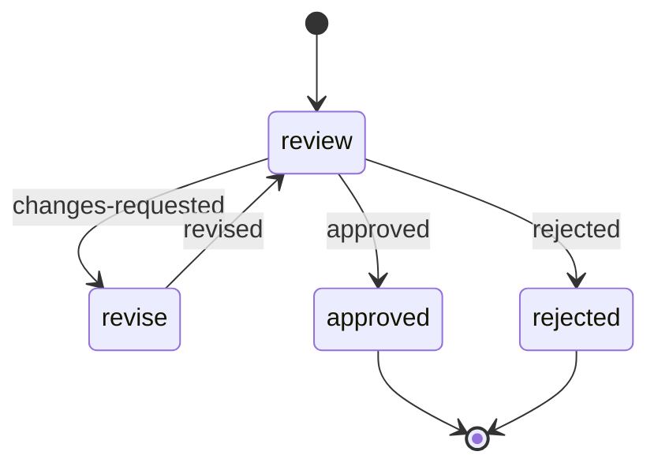

# State machine authoring guide

Use a `state-machine` block to describe a process as named stages with explicit
routes between them. It is especially useful when work can return to an earlier
stage: review and rework, stakeholder follow-up, repair and revalidation, or a
business retry with a defined stopping point.

This guide explains the model, when to choose it, and how to build and test a
machine. The [YAML reference](yaml.md#state-machine) gives the compact block contract; the
[expression guide](wfexpr.md) explains the templates used below.

## Model

A machine runs one node at a time. The node does its work and returns a
completion naming what happened; the graph maps that completion to the next
node. Responsibilities sit in different places:

| Responsibility              | Authoring location              | Example                                                          |
| --------------------------- | ------------------------------- | ---------------------------------------------------------------- |
| Business work and decisions | A node's inline body or subflow | Ask a reviewer, interpret the reply, return `changes-requested`. |
| Routing                     | The node's `on` map             | Map `changes-requested` to `revise`.                             |
| Memory between stages       | The machine's explicit state    | Carry the review count and the latest document reference.        |
| Ending the process          | A terminal node                 | Declare `approved` and return the public result.                 |
| Durable execution           | The engine                      | Preserve the active visit across waits and continue-as-new.      |

- **Name completions after what happened** (`approved`, `no-reply`,
  `needs-repair`), not where to go. The `on` map owns the destination, so one
  node can be reused under different routing.
- **Events don't move the machine.** A message, timer or human decision is
  received by a block inside the active node (`wait`, `hitl`, `scm`, `race`),
  interpreted there, and turned into a completion.
- **The current node is not state.** State is the small explicit memory later
  stages need; don't add a field that duplicates the current node or a second
  interpreter that picks the next stage.
- **Nodes share nothing implicitly.** Each visit gets copies of input and state
  in a fresh context; another node's block outputs are invisible. Facts cross
  visits only through an accepted state update.

What this buys: every exit of a node is reviewable beside it; invalid updates
and undeclared completions fail validation instead of reaching the next node;
history records each accepted edge with its completion and reason, and repeated
visits have distinct paths, so each pass through a cycle can be inspected and
tested. Durability alone is not a reason to choose a machine; other blocks are
durable too.

## When to use it

Choose a state machine when the process has meaningful named stages and the
routes between them are part of the business rules. Rework cycles, multiple
business endings, and a need to explain why a process took a particular route
are strong reasons to use one.

| Process shape                                                    | Suggested block or structure                                               |
| ---------------------------------------------------------------- | -------------------------------------------------------------------------- |
| Fetch, transform, then send, with no revisits                    | An ordinary block sequence.                                                |
| Choose one branch from a condition                               | A `router`.                                                                |
| Repeat the same operation over a collection                      | A `loop`.                                                                  |
| Run independent work concurrently                                | `parallel`; use `race` when the first branch to settle decides the result. |
| Review, revise, review again, then approve or reject             | A `state-machine`.                                                         |
| Several stages with different retry, follow-up, and ending rules | A `state-machine`, with those rules implemented in node bodies.            |

A machine's graph is sequential: one active node returns one completion per
visit. Put concurrent work inside a node using `parallel` or `race` if that
stage needs it. Keep a simple straight-line workflow as a sequence unless
named stages and explicit routes make it easier to understand.

## Build a complete machine

Start by naming the stages and endings, then write each stage's possible
completions and destinations. Decide which facts are fixed input and which
must change between visits. Finally, implement the node bodies.

Use inline `blocks` with an explicit `return` for short, local stages; use a
literal `ref` for a reusable or substantial subflow. A node declares exactly
one body form. Both get the same isolated visit context and return validation;
inline bodies cannot read outer workflow params or another node's outputs.
An empty `blocks: []` with a `return` supports a stage that only projects a
completion or terminal result. The [YAML reference](yaml.md#state-machine)
shows a mixed machine.

Inline block ids belong to the definition containing the machine, so they
must be unique across that definition, including its other inline nodes.

This executable example models review and rework. It **simulates** review
decisions using a counter, so it needs no external service or human input.
With the default parameters it requests one revision, reviews again, and
approves. Set `isRejected: true` to exercise rejection.



Save this as a workflow YAML file. All node subflows are embedded:

```yaml
ref: document-review-example
kind: workflow
params:
  reviewsRequired: { type: integer, required: false }
  isRejected: { type: boolean, required: false }

subflows:
  review-document:
    params: { input: object, state: object, node: object }
    blocks:
      - id: decide
        type: js
        with:
          code: |
            const reviews = params.state.reviews + 1;
            if (params.input.isRejected) {
              return {
                completion: "rejected",
                reason: "The simulated reviewer rejected the document.",
                stateUpdate: { reviews },
              };
            }
            if (reviews < params.input.reviewsRequired) {
              return {
                completion: "changes-requested",
                reason: "The simulated reviewer requested another revision.",
                stateUpdate: { reviews },
              };
            }
            return {
              completion: "approved",
              stateUpdate: { reviews },
            };
        out: decision
    return: '${ctx.decision}'

  revise-document:
    params: { input: object, state: object, node: object }
    blocks:
      - id: describe-revision
        type: log
        with:
          level: info
          message: 'Simulating revision after review ${params.state.reviews}'
    return:
      completion: revised

  finish-review:
    params: { input: object, state: object, node: object }
    blocks:
      - id: describe-ending
        type: log
        with:
          level: info
          message: 'Review ended at ${params.node.id}'
    return:
      result:
        reviews: '${params.state.reviews}'

blocks:
  - id: review-process
    type: state-machine
    with:
      input:
        reviewsRequired: '${params.reviewsRequired ?? 2}'
        isRejected: '${params.isRejected ?? false}'
      start: review
      state:
        schema:
          type: object
          props:
            reviews: integer
        initial: { reviews: 0 }
      max-transitions: 5
      nodes:
        review:
          ref: review-document
          on:
            changes-requested: revise
            approved: approved
            rejected: rejected
        revise:
          ref: revise-document
          on:
            revised: review
        approved:
          ref: finish-review
          terminal: { outcome: approved }
        rejected:
          ref: finish-review
          terminal: { outcome: rejected }
    out: reviewOutcome

return: '${ctx.reviewOutcome}'
```

The default route is `review → revise → review → approved`, using three
transitions. Its public return is:

```json
{ "outcome": "approved", "result": { "reviews": 2 } }
```

Two nodes can reference the same subflow, as the terminal nodes do here.
`params.node.id` tells that subflow which graph node it is executing.
For a real review, replace the simulated decision with the appropriate human
interaction and map its response to the same completion vocabulary.

## Input and state

`with.input` and `with.state.initial` resolve once when the machine starts.
Each node receives `input` (a copy of the fixed machine input), `state` (a copy
of the latest accepted state) and `node` (`{ id }`) as `params`. The exact
return shapes, state-schema rules and graph rules are in the [YAML
reference](yaml.md#state-machine); this section covers how to use them.

- Pass run facts the machine needs explicitly through `with.input`; the outer
  workflow context is not visible inside nodes. Installation `config` stays
  available through its usual binding, so keep configuration there unless the
  machine must capture a value at entry.
- Mutating `params.state` or `params.input` changes nothing. Return a
  `stateUpdate`; the next visit receives the accepted state and the original
  input.
- Input and state must survive a JSON round trip unchanged: no sparse arrays,
  non-finite numbers, negative zero, functions, `Date` objects or cycles.
- Keep state small: the document reference, decision or attempt count that
  later stages need, not every block output. State is not part of the
  machine's output; the terminal body chooses what goes into `result`.

Updates are **shallow top-level patches**. Given:

```yaml
# Current state
document: { version: 1, reference: draft-001 }
reviews: 1

# Returned stateUpdate
document: { version: 2 }
```

The next state's `document` is `{ version: 2 }`; `reference` is gone and
`reviews` stays `1`. Return the whole nested object when its other fields must
survive. Validation runs on the merged candidate state.

## Endings and failures

A terminal return has no `completion` or `stateUpdate`, so commit any final
state change on the edge entering the terminal. The terminal's `outcome`
belongs to the graph; the machine combines it with the node body's
`{ result, reason? }` into `{ outcome, reason?, result }` at `out`. A
transition's `reason` explains a decision to a reader and stays in transition
history; it never selects an edge.

Use terminal outcomes for expected business endings such as `rejected`,
`no-reply` or `attempts-exhausted`: reaching one completes the workflow
normally, even when the business request was refused. An unhandled inner error
or an invalid node return fails the execution; the machine never turns it into
a completion.

## Bounded repetition and side effects

Self-transitions and cycles are allowed; a self-transition is a fresh visit
that runs the body again and counts as an edge. A path to a terminal existing
in the graph doesn't mean node decisions will ever take it.

`max-transitions` counts accepted **edges**, not time or activity attempts; a
terminal reached on the last allowed edge still runs. In the example, three
reviews need five edges, so a fourth review hits the bound. Treat it as a
safety net: exhausting it fails execution. Put business limits in nodes as an
explicit counter and an `attempts-exhausted` completion to a terminal. The
bound never times out a waiting node; use the waiting and racing blocks for
deadlines.

Accepting an edge is one atomic boundary: the engine validates the completion,
the candidate state and the edge budget, records the transition, then commits
state and target. A failed check records no edge and keeps the last accepted
state. It does **not** roll back emails, HTTP calls or other effects already
performed in the node, and a revisit runs the body again, so repeated external
operations need idempotency or compensation.

## Test the routes and inspect visits

Test every declared completion, expected terminal outcome and meaningful cycle.
For revisits, assert the sequence of node returns and the state later visits
receive. Cover the business exhaustion route and, where repetition matters, the
`max-transitions` bound. A machine-level mock is fine for testing the caller but
bypasses the node bodies and proves nothing about routing. Path and matcher
rules for visits are in the [testing guide](testing.md#state-machine-visits) and the [path
guide](paths.md).

For the complete example, save this beside the workflow as
`document-review-example.test.yaml`:

```yaml
ref: document-review-example
e2e:
  - it: rework returns to review and preserves the review count
    events:
      - on: review-process.*.review
        expect-out-seq:
          - completion: changes-requested
            reason: The simulated reviewer requested another revision.
            stateUpdate: { reviews: 1 }
          - completion: approved
            stateUpdate: { reviews: 2 }
      - on: review-process.*.approved
        expect-in:
          input: { reviewsRequired: 2, isRejected: false }
          state: { reviews: 2 }
          node: { id: approved }
      - on: review-process
        expect-out: { outcome: approved, result: { reviews: 2 } }
    post-run:
      - return: { outcome: approved, result: { reviews: 2 } }
      - status: completed
```

Runtime node paths carry a zero-based **global visit index**
(`review-process.0.review`, `review-process.1.revise`,
`review-process.2.review`). Matchers use `*` for it: wftest checks
reachability with index `0`, so a literal later index is rejected. The test
above asserts the committed state at `review-process.*.approved`, after both
reviews.

Run it with `-v` on the first failure; the
[testing guide](testing.md#state-machine-visits) covers setup, mocks and tiers.


wftest's `e2e` tier still mocks side effects; a real workflow also needs a run
of its use case against real integrations.

