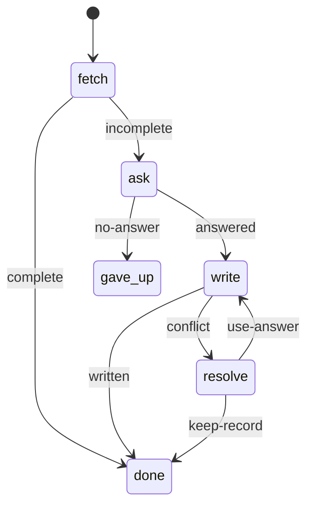

# 05 Record request (reference app)

Makes sure a job record has access notes and a parking answer before a visit.
This is the template to copy for a real application: it combines the others
in a `state-machine`.

| Node      | Body                        | Does                                                       |
| --------- | --------------------------- | ---------------------------------------------------------- |
| `fetch`   | `acme-record-fetch` subflow | Reads the job and its contact (`http`)                     |
| `ask`     | inline                      | Asks the contact for what is missing (`scm`)               |
| `write`   | inline                      | Cleans the answer (`js`), re-reads the job, writes it back |
| `resolve` | inline                      | Asks an operator when someone changed the record (`hitl`)  |

- **State** is the memory between nodes: the contact, the answers and the
  `force` flag. It is a closed schema, so a node cannot add a key by mistake.
- **Nodes see nothing of each other.** A visit gets `params.input`,
  `params.state` and `params.node`; anything else crosses through a
  `stateUpdate`.
- **Completions name what happened** (`conflict`, `no-answer`); the `on` map
  decides where that leads.
- The `write` node is visited twice on the conflict path. Each visit has its
  own path, `record.<visit>.write`, so tests match with `record.*.write`.

`manifest.yaml` declares the configuration as `install` fields and no setup
wizard: concluding setup starts `activates` once with no params, and this
workflow needs a `jobId`. Template 06 shows a wizard.

**Tests**

| Test                      | Proves                                               |
| ------------------------- | ---------------------------------------------------- |
| `normalize-answers` units | Cleaning and capping the contact's text              |
| `check-conflict` units    | When changed notes or parking count as a conflict    |
| `acme-record-fetch` e2e   | The `fetch` node's completion and state update       |
| workflow e2e              | Every route through the machine, one test per ending |
